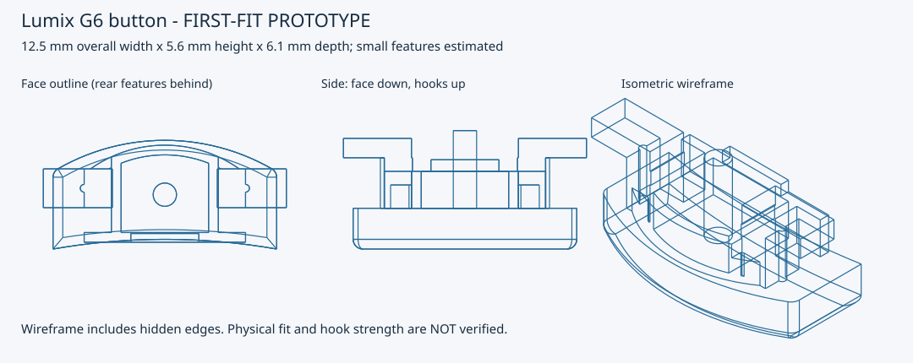
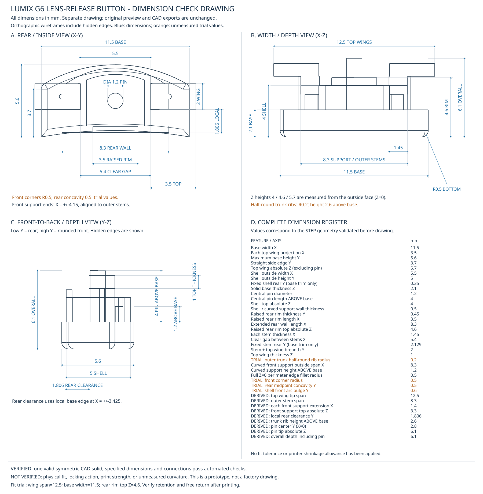

# Lumix G6 lens-release button: first-fit prototype

This is an **approximate replacement**, not a verified factory reproduction.
It uses the owner's five photographs in `photos/`, rather than copying the
different VGU0P89 part shown in the retailer's listing.

## Preview



[Open the full-size preview](./lumix_g6_button_prototype.svg).

## Dimensioned drawing



[Open the full-size dimensioned drawing](./lumix_g6_button_dimensions.svg)
to inspect the dimension labels. All dimensions are in millimetres; orange
values are unmeasured trial values. Hidden edges are included in both drawings.
Geometric validation does not establish physical fit or strength.

## Dimensions and assumptions

Current owner-specified dimensions (including fit-trial adjustments):

- **11.5 mm button base width**; the wing span is a separate measurement.
- **5.6 mm** maximum face height along Y; **3.7 mm** side edges at both ends.
  These replace 5.7 mm and 4 mm after the first print bound in the camera.
- 5.7 mm total front-to-back depth.
- Two symmetric wings; no central rear protrusion.
- Centered hollow shell: **5.5 mm outside width x 5 mm outside height**.
  Its rear is fixed at **Y=0.35 mm**, rather than recentered when the base changes.
- Solid button base thickness: **2.10 mm**.
- The entire outside-face perimeter at **Z=0 has an R0.5 mm edge fillet**.
  This is a 3D bottom-edge round, separate from the R0.5 plan-view front
  corners. It removes material only in the bottom 0.5 mm band; the upper base
  face, shell, wings and supports are unchanged.
- General shell walls end **4 mm from the outside/front face**.
- The straight rear shell wall extends sideways to **8.3 mm total length**,
  retaining its **0.5 mm thickness** and **4 mm absolute height**.
- Only the centered **3.5 mm length** of that wall has a raised rim:
  **0.45 mm thick** in Y, ending
  **4.6 mm from the outside/front face** (0.6 mm above the other walls).
  This raises only the center rear rim by 0.2 mm from its previous 4.4 mm height;
  its 3.5 mm length and 0.45 mm thickness are unchanged.
- **0.5 mm shell walls**; only the side facing the button's arched edge bulges.
- Wings attach directly to the shell sides. Each top wing projects **3.5 mm**
  from the 5.5 mm shell, giving a **12.5 mm wing span**. Both top tips extend
  **0.5 mm beyond the 11.5 mm base width** to address the button falling out.
  This retention trial replaces the 3 mm projection and 11.5 mm wing span;
  stems, shell, base and front reinforcement are unchanged.
- Wing stem thickness along X: **1.45 mm**; top hook thickness along Z: **1 mm**.
  The stem thickness supersedes 1.5 mm to retain the 5.4 mm clear gap while
  matching the **8.3 mm outer stem span**.
- **Trunk reinforcement trial:** a vertical half-cylinder centered on the
  outward-facing surface of each wing stem, away from the central cavity.
  Each rib has **0.2 mm radius**, **0.4 mm breadth along Y** and **0.2 mm
  outward projection along X**. It runs **2.6 mm along Z**, from the base
  at Z=2.1 mm to the hook underside at Z=4.7 mm.
  These small permanent ribs replace the triangular gussets entirely; they
  do not reach the wing tips or ramp beneath the lips. The top surfaces,
  1 mm hook plate, 12.5 mm span, base, shell and stem spacing are unchanged.
  Clearance for the outward ribs still needs a physical fit check.
- Both stems and top wings have **2 mm front-to-back breadth along Y**,
  replacing the earlier 1.3 mm estimate. Their rear faces stay fixed at the
  measured rear clearance; the added breadth extends towards the front.
- Clear distance between the stem inner faces: **5.4 mm**, not center-to-center.
  Each stem overlaps the 5.5 mm shell's side wall by 0.05 mm, preserving direct
  attachment without entering its cavity. Hook tips have a 12.5 mm span.
- Each stem's rear face remains fixed at **Y=2.129095068291875 mm**, preserving
  the pre-trim position. The original local rear clearance was 2 mm at
  X=+/-3.425 mm; trimming the rear base changes that clearance, not the stems.
  The drawing reports the new clearance as a derived value.
- Two front reinforcing walls follow the shell's circular front curvature.
  Their total outside span is **8.3 mm**, with tips aligned to the stem outer
  faces, not the 12.5 mm top-hook tips. Each extends **1.4 mm sideways along X**
  beyond the shell, superseding the earlier 2 mm extension. Each has **0.5 mm
  radial wall thickness** and rises **1.2 mm above the base** (absolute Z=3.30 mm).
  They are low curved wall extensions, not straight ribs or raised hook lips.
  Each joins both the shell and its wing stem; the cavity remains open.

The top wings are rectangular and deliberately extend 0.5 mm past each side of
the base, not trimmed to its rounded plan outline. The model's overall width is
therefore 12.5 mm, while the base remains 11.5 mm. Stem footprints remain within
the base. Retention and free movement still require a new physical fit test.

The front arc profile is a **photo-based estimate**.
The 1.45 mm stem measurement is its X thickness,
not its Z height; overall Z depth remains 5.7 mm.
The rear face edge curves inward by a fit-trial value of **0.5 mm**
at the midpoint, replacing 0.2 mm. The straight side edges run from Y=0 to Y=3.7;
the front arc peaks at Y=5.6. The front corners retain the trial **0.5 mm radius**,
tangent to the straight sides and the front arc. The arc is recalculated to
retain both the 3.7 mm straight side edges and the 5.6 mm maximum height.
Rear corners are not rounded. Original moulding fillet dimensions remain unmeasured.
The central shell has straight left/right and rear walls and a circular-arc
front wall facing the arched button edge. Its bulge is estimated at 0.6 mm from
the arc endpoints to their midpoint; the 5 mm height includes this bulge.
The inner outline is offset inward by
0.5 mm, rather than shrinking the outline proportionally. The shell is open at
the rear and closed by the button face at the front, with no central pin.
The shell replaces the earlier, incorrect full-width rear perimeter wall.
The wings are modelled as mirrored L-shaped hooks. The original face curvature,
edge rounding, moulding draft and small internal details are not reproduced
exactly. Photographs do not establish those dimensions reliably.

Coordinates: X is width, Y is face height, and Z runs from the flat outside
face at zero towards the camera interior. The rear face edge is slightly
concave (low Y); the opposite edge is arched (high Y, shell bulge).
The shell's rear wall remains straight; the new concavity applies to the
button base outline only. Shell, wing and reinforcing-wall positions are
fixed for this fit trial. The rear shell wall intentionally overhangs the
new base outline near the center; it has not been trimmed or relocated.
Shell/rim heights are absolute Z coordinates, including the 2.10 mm base,
not additional extrusion lengths. No print-clearance or shrinkage compensation
has been applied.

## Files

- `lumix_g6_button_prototype.stl`: printable mesh, in millimetres.
- `lumix_g6_button_prototype.step`: editable CAD solid.
- `lumix_g6_button_prototype.FCStd`: FreeCAD document with dimension metadata.
- `lumix_g6_button_prototype.svg`: three wireframe views, including hidden edges.
- `lumix_g6_button_dimensions.svg`: separate dimensioned orthographic drawing
  with all source dimensions, derived values and explicitly marked trial values.
- `create_drawing.py`: creates only the dimensioned drawing from the exported
  STEP, after validating it against the current source dimensions. It does not
  overwrite the original preview or CAD exports.
- `create_button.py`: adjustable source; edit the `Dimensions` defaults and rerun.

The FreeCAD object's dimension properties are read-only records of the source
values, not a live parametric feature tree. Change the Python source to regenerate
the geometry, or directly edit the exported solid in your CAD application.
Regeneration overwrites the named output files; use another output directory
to preserve a trial.

## Regenerate on this Mac

FreeCAD is already installed. No additional packages are required:

```sh
PYTHONPATH=/Applications/FreeCAD.app/Contents/Resources/lib \
  /Applications/FreeCAD.app/Contents/Resources/bin/python create_button.py
```

Optional: append `--output-dir /absolute/path/to/trial`.

To update the separate dimensioned drawing after regenerating the default STEP:

```sh
PYTHONDONTWRITEBYTECODE=1 \
PYTHONPATH=/Applications/FreeCAD.app/Contents/Resources/lib \
  /Applications/FreeCAD.app/Contents/Resources/bin/python create_drawing.py
```

The drawing includes hidden edges as solid wireframe lines, not a hidden-line
removed engineering projection. Dimensions are in millimetres; do not measure
screen pixels or infer print scale. Its table distinguishes unmeasured trial
values from measured/derived dimensions. It does not certify physical fit.

The generator checks CAD validity, one connected solid, measured envelope,
left/right symmetry, absence of a central rear pin, central shell dimensions,
wall offset and hollow geometry, rear-only raised rim length/thickness/height,
extended rear wall span/thickness/height, face end heights and rear concavity, base thickness,
directly attached wing stems, hook thickness, symmetric 12.5 mm wing span,
centered half-cylinder trunk ribs and unchanged surrounding lip geometry,
5.4 mm clear stem spacing, fixed stem positions and derived local rear clearance,
2 mm front-to-back breadth for both stems and top wings,
curved reinforcement dimensions/thickness and connection to the shell and stems,
two 0.5 mm front corner rounds, STEP round-trip validity,
the complete R0.5 bottom-perimeter fillet and preserved upper base,
and a closed, single-component STL with matching dimensions and volume.
These checks establish geometric integrity, **not mechanical fit**.

## First print and fitting

Fine-detail nylon printing or a tough engineering resin is preferable for the
small hooks. Standard brittle resin can snap at the wing roots. Fine-nozzle FDM
can be used for a fit trial, but inspect whether the hook details actually resolve.
Ask your printer/service about minimum reliable feature size and tolerances.

Print at **100% scale in millimetres**. The STL's face-down coordinates are a
modelling convention, not a prescribed resin orientation. Orient/support for your
process, keeping support marks off the hook engagement surfaces.

For the PLA FDM trial that curled when printed on its side / tilted, try the
outside face down on the bed (Z=0), with the hooks printed last. In that
orientation the half-round ribs grow vertically from the base to the hooks.
They stiffen the trunks but leave the wing-tip overhangs largely unsupported;
unlike the removed triangular gussets, they do not provide a 45-degree ramp.
The R0.5 bottom fillet reduces the first-layer footprint, so check adhesion.
Use effective part cooling for PLA and enough layer time for this tiny part
to cool, for example by printing several spaced copies. Follow the filament's
temperature recommendations. A 0.4 mm-wide rib may be marginal with a 0.4 mm
nozzle: inspect the sliced toolpaths to confirm that it resolves. These ribs
do not guarantee curl-free printing or remove the need for overhang support.
Recheck clearance around the reinforced trunks before installation.

Compare the print with the original outside the camera first. Check face
clearance, wing span, hook thickness, cavity and total travel. Do not force
installation or attach a lens until the button moves freely, returns fully, and
the original locking mechanism operates correctly. Remove the battery before
working on the camera. Avoid loose plastic or sanding debris inside the body.

Measure the intact wing and shell before treating this as a final part.
Adjust local dimensions instead of globally scaling the confirmed envelope.
